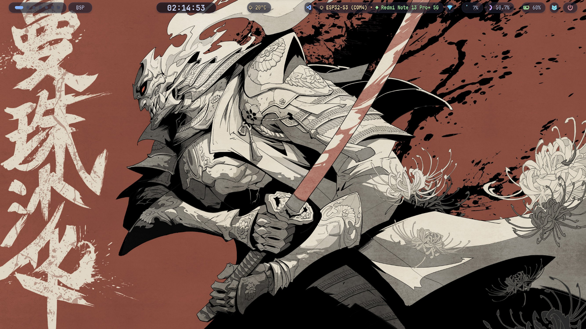
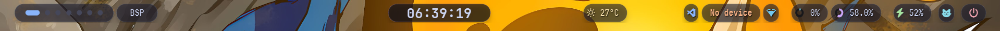
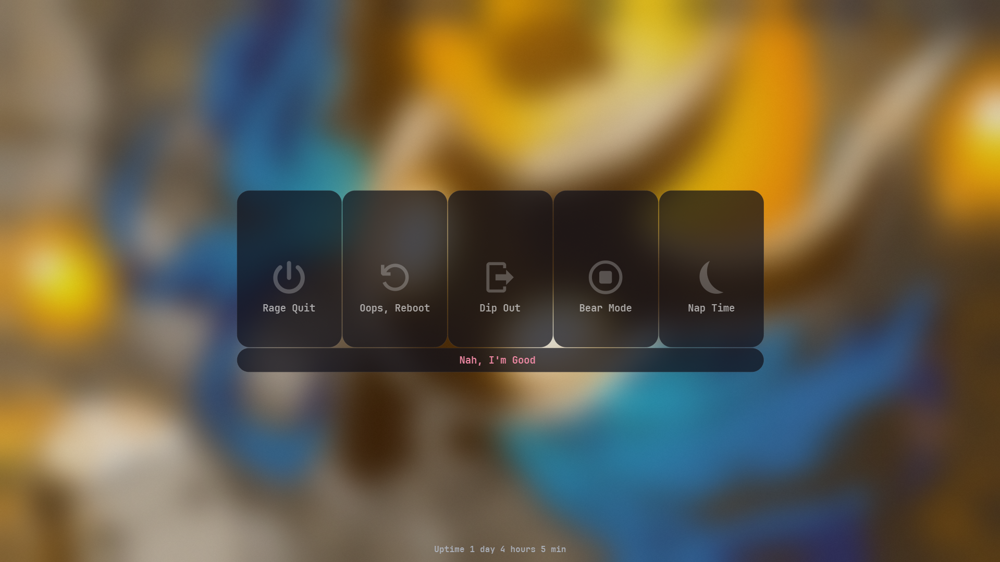
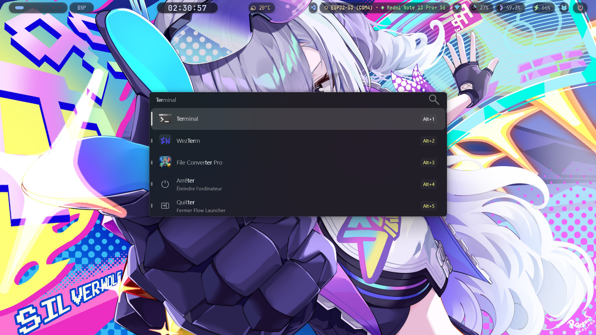
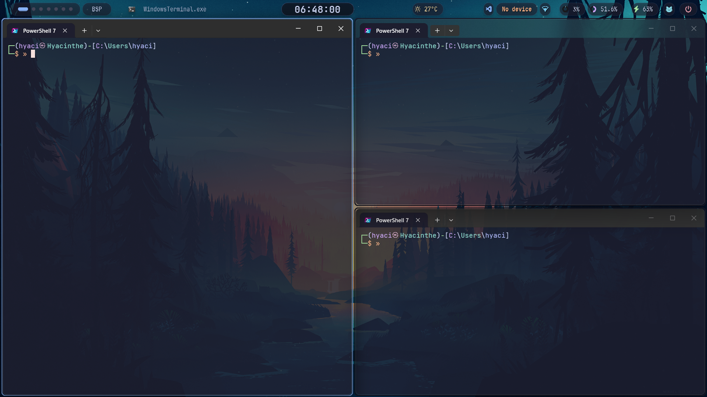
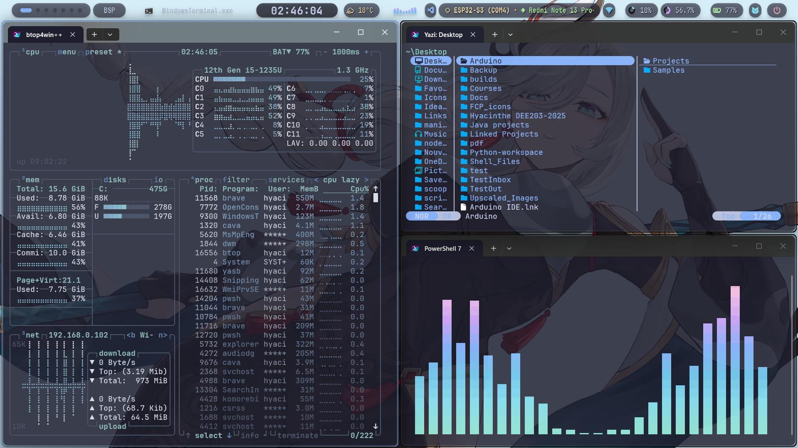
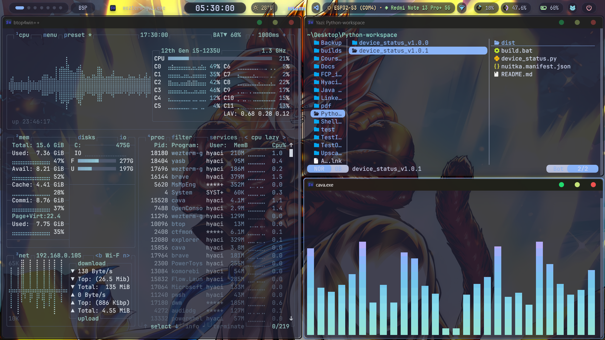
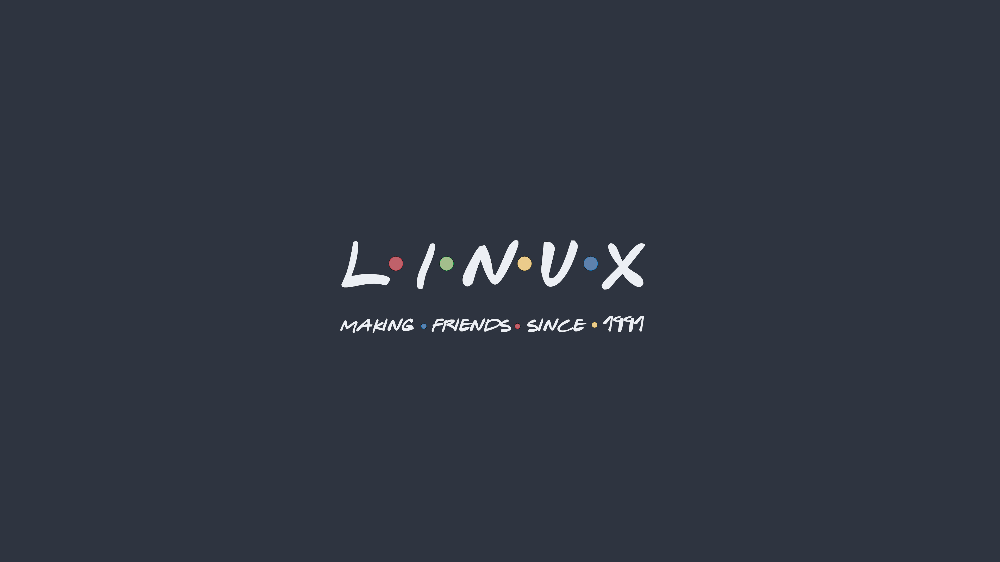
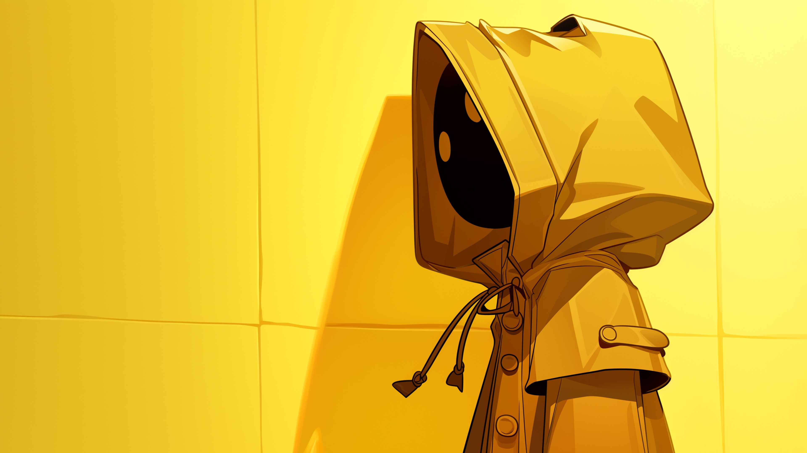
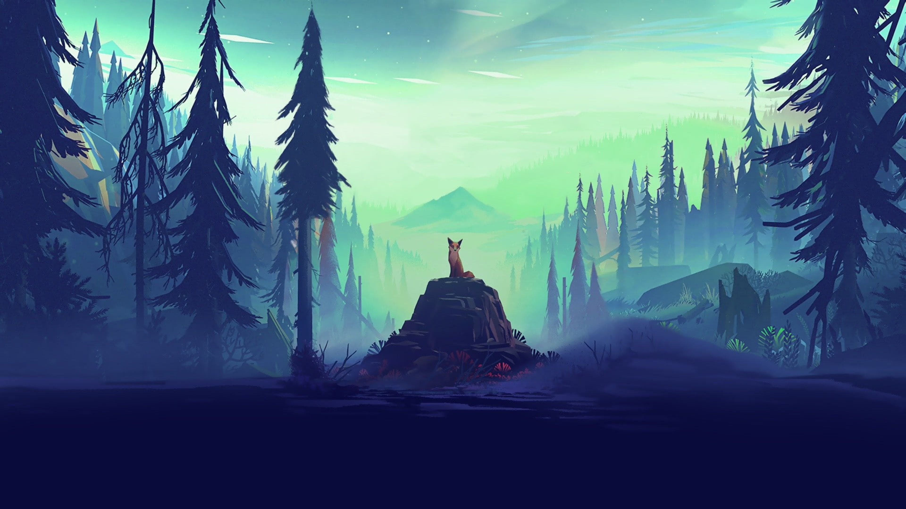

# MochaGlass

A Catppuccin Mocha, glass-style desktop setup for Windows, built on top of Komorebi (tiling window manager), YASB (status bar), Cava (audio visualizer), and Flow Launcher, with a custom native widget for monitoring connected serial boards, phones, and USB drives.


[](https://github.com/Hyacinthe-primus/MochaGlass/actions/workflows/ci.yml)
[](https://github.com/Hyacinthe-primus/MochaGlass/actions/workflows/validate.yml)

[](https://github.com/Hyacinthe-primus/MochaGlass/stargazers)
[](https://github.com/Hyacinthe-primus/MochaGlass/commits)
[](https://github.com/Hyacinthe-primus/MochaGlass/releases)
[](https://github.com/Hyacinthe-primus/MochaGlass/issues)
[](LICENSE.md)

---

## Table of Contents

- [Overview](#overview)
- [Preview](#preview)
  - [Desktop Overview](#desktop-overview)
  - [YASB Status Bar](#yasb-status-bar)
  - [Control Center](#control-center)
  - [App Launcher](#app-launcher)
  - [Tiling Window Manager](#tiling-window-manager)
  - [Wallpapers](#wallpapers)
- [Stack](#stack)
- [Prerequisites](#prerequisites)
- [Installation](#installation)
  - [Quick install (recommended)](#quick-install-recommended)
  - [1. Install the base tools](#1-install-the-base-tools)
  - [2. Get the config files](#2-get-the-config-files)
  - [3. Set up Komorebi and whkd](#3-set-up-komorebi-and-whkd)
  - [4. Get device_status.exe](#4-get-device_statusexe)
  - [5. Set up Windows Terminal](#5-set-up-windows-terminal)
  - [6. Set up Flow Launcher](#6-set-up-flow-launcher)
  - [7. Update the placeholders](#7-update-the-placeholders)
  - [8. Restart the bar](#8-restart-the-bar)
- [Building device_status from source](#building-device_status-from-source)
- [Troubleshooting](#troubleshooting)
- [Credits](#credits)
- [License](#license)

---

## Overview

MochaGlass is a full ricing setup for Windows that replaces the default shell chrome with a tiling workflow and a translucent, Catppuccin Mocha themed status bar. It combines:

- **Komorebi** for tiling window management, driven through **whkd** keybindings
- **YASB** (Yet Another Status Bar) for the top bar, widgets, control center and wallpaper picker
- **Cava** for the live audio visualizer embedded in the bar
- **Flow Launcher** as the application launcher
- A custom compiled widget, **device_status.exe**, that reports connected serial boards (ESP32, Arduino), phones, and USB drives directly inside the bar

Everything is themed consistently: same accent colors, same blur and rounded corner treatment, same icon font across the bar, the launcher, and the tiling overlays.

## Preview

### Desktop Overview

| | |
|---|---|
|  |  |

### YASB Status Bar



The bar shown above includes the workspace indicator, active window title, clock, weather, Cava visualizer, VS Code widget, the custom device status widget, CPU, memory, wallpaper picker, and power menu. Every label is in English, including the device status widget (`No device`, `device(s) connected`). Wi-Fi and battery are defined in `config.yaml` but commented out of the default layout; uncomment them if your machine reports them.

### Control Center



### App Launcher



Flow Launcher is themed to match the rest of the setup and used as the primary app and file launcher. The installer switches its language to English; the screenshot above predates that change.

### Tiling Window Manager

Komorebi in action across different layouts and wallpapers.

| | | |
|---|---|---|
|  |  |  |

### Wallpapers

The set currently cycled by the `wallpapers` widget, stored in `Wallpapers/`.

| | | |
|---|---|---|
|  |  |  |
| Broken Vessel | Manjusaka | Shenhe |
|  |  |  |
| Silver Wolf | Gogeta SSJ4 | Linux Friends |
|  |  |  |
| Little Nightmares | Small Memory | Survey |

Drop your own images into `Wallpapers/` and point `wallpapers.image_path` at that folder (see [Update the placeholders](#5-update-the-placeholders)) to use them instead.

---

## Stack

| Component | Role | Repository |
|---|---|---|
| [Komorebi](https://github.com/LGUG2Z/komorebi) | Tiling window manager | LGUG2Z/komorebi; config in `MochaGlass_Komorebi/` |
| [whkd](https://github.com/LGUG2Z/whkd) | Hotkey daemon used to drive Komorebi | LGUG2Z/whkd; keybindings in `MochaGlass_Komorebi/` |
| [YASB](https://github.com/amnweb/yasb) | Status bar, control center, wallpaper widget | amnweb/yasb; config in `MochaGlass_YASB/` |
| [Cava](https://github.com/karlstav/cava) | Console audio visualizer, piped into the bar | karlstav/cava; config in `MochaGlass_Cava/` |
| [Flow Launcher](https://github.com/Flow-Launcher/Flow-Launcher) | Application launcher | Flow-Launcher/Flow-Launcher; theme in `MochaGlass_FlowLauncher/` |
| device_status.exe | Custom widget: serial boards, phones, USB drives | Included in this repo, `device_status/` |
| Windows Terminal | Terminal, themed to match the rest of the setup | Included in this repo, `MochaGlass_Terminal/` |
| [JetBrainsMono Nerd Font](https://github.com/ryanoasis/nerd-fonts) | Icon font used across the bar and terminal (NF + NFP families) | ryanoasis/nerd-fonts |

---

## Prerequisites

- Windows 10 or Windows 11
- [Komorebi](https://github.com/LGUG2Z/komorebi) and [whkd](https://github.com/LGUG2Z/whkd) installed and on PATH
- [YASB](https://github.com/amnweb/yasb) installed
- [Cava](https://github.com/karlstav/cava) available for Windows (used by the `cava` widget)
- [Flow Launcher](https://www.flowlauncher.com/) installed
- [Windows Terminal](https://apps.microsoft.com/detail/9n0dx20hk701) installed (the tiling screenshots above all use it)
- **JetBrainsMono Nerd Font** (the `NF` and `NFP` families) installed system wide (icons will render as boxes or blank glyphs otherwise)
- PowerShell available as `pwsh` or `powershell` (bundled with Windows by default, used internally by `device_status.exe`)
- A folder of wallpapers you own the rights to, for the wallpaper widget
- Only required if you rebuild `device_status.exe` yourself instead of using the release build: Rust 1.97 or newer

## Installation

### Quick install (recommended)

`install.ps1` is a one-shot installer for Windows 10/11. Run it from the repository root:

```powershell
powershell -ExecutionPolicy Bypass -File .\install.ps1
```

It installs any missing app with WinGet (Komorebi, whkd, YASB, Cava, Flow Launcher, Windows Terminal), installs the JetBrainsMono Nerd Font, deploys every configuration in this repository, installs `device_status.exe` into `%USERPROFILE%\scripts`, merges the Catppuccin Mocha theme into Windows Terminal, enables autostart, and starts Komorebi + YASB. Existing YASB, Cava, Komorebi, whkd, Flow Launcher, and Terminal files are backed up before they are replaced.

Useful parameters:

| Parameter | Effect |
|---|---|
| `-DryRun` | Print every action without changing anything |
| `-NoElevate` | Do not relaunch as administrator (some installs may fail) |
| `-SkipApps`, `-SkipFont`, `-SkipConfigs`, `-SkipWidget`, `-SkipTerminal` | Skip that part |
| `-NoStart`, `-NoAutostart` | Do not start or register Komorebi/YASB |
| `-WeatherApiKey <key> -WeatherCity <city>` | Enable the weather widget |
| `-WallpaperPath <folder>` | Use another wallpaper folder |
| `-BuildWidget` | Build `device_status.exe` with Cargo instead of downloading it |
| `-DeviceStatusSource <exe>` | Use a specific `device_status.exe` |

The installer writes a log to `%TEMP%`. Re-running it is safe. The manual steps below remain available if you prefer to set everything up by hand.

### 1. Install the base tools

Install Komorebi, whkd, YASB, Cava, and Flow Launcher first, following each project's own setup instructions linked above. Confirm Komorebi starts correctly on its own before layering YASB on top of it.

Then get a copy of this repository:

```bash
git clone https://github.com/Hyacinthe-primus/MochaGlass.git
```

### 2. Get the config files

You have two options.

**Option A: use the pre-built config archive**

1. Go to the [Releases](https://github.com/Hyacinthe-primus/MochaGlass/releases) page of this repository
2. Download `default.config.zip`
3. Extract it directly into `C:\Users\<YourUsername>\`

This produces:

```
.config\yasb\config.yaml
.config\yasb\styles.css
.config\cava\config
.config\whkdrc
komorebi.json
AppData\Roaming\FlowLauncher\Themes\TranslucentFlow.xaml
```

**Option B: use the raw templates**

Copy the contents of `MochaGlass_YASB/` into `C:\Users\<YourUsername>\.config\yasb\`, and the contents of `MochaGlass_Cava/` into `C:\Users\<YourUsername>\.config\cava\`. Copy `MochaGlass_Komorebi\komorebi.json` to `C:\Users\<YourUsername>\komorebi.json` and `MochaGlass_Komorebi\whkdrc` to `C:\Users\<YourUsername>\.config\whkdrc`. Copy `MochaGlass_FlowLauncher\TranslucentFlow.xaml` into `C:\Users\<YourUsername>\AppData\Roaming\FlowLauncher\Themes\`. This is the same content as `default.config.zip`, but as plain files instead of an archive, useful if you want to diff or version your own changes before deploying them.

All labels in the YASB bar are in English, including the device status widget (`No device`, `device(s) connected`). If you still see the old French label `carte(s) connectée(s)`, you extracted an old release archive; use the installer or the latest `default.config.zip`.

### 3. Set up Komorebi and whkd

The repository now ships the Komorebi configuration and the whkd keybindings used in the screenshots, so you no longer need to run `komorebic quickstart` and edit the generated examples by hand.

1. Copy `MochaGlass_Komorebi/komorebi.json` to `C:\Users\<YourUsername>\komorebi.json`
2. Copy `MochaGlass_Komorebi/whkdrc` to `C:\Users\<YourUsername>\.config\whkdrc`
3. Fetch the upstream application rules used by Komorebi:
   ```powershell
   komorebic fetch-app-specific-configuration
   ```
   This creates `C:\Users\<YourUsername>\applications.json`. The installer does this automatically when the file is missing.
4. Start (or restart) Komorebi:
   ```powershell
   komorebic stop --whkd
   komorebic start --whkd
   ```

The shipped configuration uses the Catppuccin Mocha theme, 3 px borders, 2 px workspace and container padding, transparency for unfocused windows, `EaseOutBack` animations, and seven named workspaces (`I` to `VII`). YASB is the taskbar/bar in this setup, so there is no `komorebi.bar.json` to install.

The main whkd bindings are:

| Keys | Action |
|---|---|
| `Alt + Left/Right/Up/Down` | Focus a window |
| `Alt + Shift + Arrow` | Move a window |
| `Alt + 1..7` | Focus workspace `I`..`VII` |
| `Alt + Shift + 1..7` | Move the focused window to a workspace |
| `Alt + F` | Toggle floating |
| `Alt + Shift + F` | Toggle monocle |
| `Alt + Q` | Retile |
| `Alt + P` | Pause Komorebi |
| `Alt + O` | Reload whkd itself |
| `Alt + Shift + O` | Reload the Komorebi configuration |

### 4. Get device_status.exe

1. Go to the [Releases](https://github.com/Hyacinthe-primus/MochaGlass/releases) page of this repository
2. Download `device_status.exe` from the latest release (currently `v1.0.3`, which matches the crate version)
3. Move it into `C:\Users\<YourUsername>\scripts\`

### 5. Set up Windows Terminal

The Windows Terminal settings in `MochaGlass_Terminal/settings.json` add the Catppuccin Mocha color scheme, the `JetBrainsMono NF` font, and the translucent/padding look used in every screenshot above. It only ships with profiles that exist on a stock Windows install (Windows PowerShell, Command Prompt, PowerShell 7, Azure Cloud Shell, Visual Studio, WSL/Ubuntu), nothing hardcoded to a specific machine or username.

1. Open Windows Terminal, then Settings, then click **Open JSON file** (or press `Ctrl+Shift+,`) to find your own `settings.json`, usually at:
   ```
   %LOCALAPPDATA%\Packages\Microsoft.WindowsTerminal_8wekyb3d8bbwe\LocalState\settings.json
   ```
2. Back up that file if you already have custom profiles in it
3. Replace its contents with `MochaGlass_Terminal/settings.json` from this repo, or merge the `schemes`, `profiles.defaults`, `actions`, and `keybindings` blocks into your existing file
4. If PowerShell 7 is not installed at `C:\Program Files\PowerShell\7\pwsh.exe` on your machine, update or remove that profile's `commandline` and `icon` paths, or just delete that profile and let Windows Terminal fall back to Windows PowerShell

**Optional: ESP-IDF profile.** If you use ESP-IDF and want a dedicated profile for it, add an entry like this to `profiles.list`, adjusting the paths to where ESP-IDF and its PowerShell profile script are actually installed on your machine:

```json
{
    "commandline": "powershell.exe -NoExit -ExecutionPolicy Bypass -NoProfile -Command \"& {. 'C:\\Path\\To\\Espressif\\tools\\Microsoft.vX.X.PowerShell_profile.ps1' }\"",
    "guid": "{915cb41c-09ee-4ec9-915c-09ee915cb41c}",
    "hidden": false,
    "icon": "C:\\Path\\To\\Your\\Icon.ico",
    "name": "ESP-IDF",
    "startingDirectory": "%USERPROFILE%\\Desktop"
}
```

This is left out of the shipped `settings.json` on purpose since not everyone has ESP-IDF installed, and the original version hardcoded one specific username and tool path.

### 6. Set up Flow Launcher

1. Copy `MochaGlass_FlowLauncher/TranslucentFlow.xaml` into `C:\Users\<YourUsername>\AppData\Roaming\FlowLauncher\Themes\`
2. Open Flow Launcher, go to **Settings**, and select:
   - **Theme**: `TranslucentFlow`
   - **Language**: `English`
   - **Color scheme**: `System`
3. Restart Flow Launcher if the theme does not apply immediately.

The installer copies the theme and switches the language to English automatically when it finds Flow Launcher's `%APPDATA%\FlowLauncher\Settings\Settings.json`. The theme is the translucent, rounded-corner look shown in the screenshot; it uses Flow Launcher's own font settings, so set the query and result fonts to `JetBrainsMono NFP` in the same settings page if you want the launcher to match the bar's monospace text exactly.

### 7. Update the placeholders

Open `C:\Users\<YourUsername>\.config\yasb\config.yaml` and replace the placeholder values with your real ones:

| Setting | Placeholder in the repo | Replace with |
|---|---|---|
| `board_status.exec_options.run_cmd` | `C:\\Users\\Username\\scripts\\device_status.exe` | `C:\\Users\\<YourUsername>\\scripts\\device_status.exe` |
| `weather.api_key` | `YOUR_OPENWEATHERMAP_API_KEY` | Your own OpenWeatherMap API key |
| `weather.location` | `Your_City_Name` | Your city name, or `lat,lon` coordinates |
| `wallpapers.image_path` | `C:/Users/Username/Pictures/Wallpapers` | The real path to your own wallpaper folder |

The two paths use backslashes for the executable and forward slashes for the wallpaper folder. Keep the same slash style when you edit them, YAML strings here are passed through as is. The installer fills all four values automatically, and every label in the shipped file is in English.

Weather is optional. If you don't want it, remove `weather` from the `right` list under `bars.primary-bar.widgets` instead of filling in the API key. The installer does this for you when no API key is supplied.

### 8. Restart the bar

`watch_config` and `watch_stylesheet` are enabled, so YASB should pick up the change automatically. If it does not, reload or restart it:

```powershell
yasbc reload
```

If you changed `komorebi.json` or `whkdrc`, restart Komorebi so the new configuration and keybindings are loaded:

```powershell
komorebic stop --whkd
komorebic start --whkd
```

---

## Building device_status from source

Only needed if you want to modify `src/main.rs` yourself instead of using the release build.

```bash
cd device_status
cargo build --release
```

`build.rs` injects the Windows VERSIONINFO metadata (file description, product name, company, version) into the binary at compile time, straight from `Cargo.toml`, so there is no separate manifest step. The crate version is kept in sync with the release tags (`1.0.3` at the time of writing), which means the file properties on the built `.exe` show the same version as the GitHub release. The finished, self-contained binary lands at:

```
device_status\target\release\device_status.exe
```

Copy that single `.exe` to wherever `run_cmd` in `config.yaml` points, then upload it directly as a release asset if you intend to publish it.

---

## Troubleshooting

- **Icons show up as boxes or missing glyphs**: JetBrainsMono Nerd Font (the `NF`/`NFP` families) is not installed, or not set as the default in your terminal/DPI scaling. Reinstall the font and restart YASB.
- **The bar still says `carte(s) connectée(s)`**: that is the old French string from an old `default.config.zip`. Replace the extracted `.config\yasb\config.yaml` with `MochaGlass_YASB/config.yaml`, or run `install.ps1`, which always deploys the English file.
- **`board_status` widget always shows "No device"**: the path in `run_cmd` does not match where you actually placed `device_status.exe`.
- **Windows flags `device_status.exe` as unrecognized (SmartScreen)**: expected for an unsigned, freshly compiled Rust binary. Either build it yourself with `cargo build --release`, or allow it manually if you trust the release.
- **Komorebi ignores the shipped borders/keybindings**: confirm `komorebi.json` is at `%USERPROFILE%\komorebi.json` (or under `KOMOREBI_CONFIG_HOME`), `whkdrc` is at `%USERPROFILE%\.config\whkdrc`, then run `komorebic stop --whkd` and `komorebic start --whkd`. `komorebic check` prints the paths it is using.
- **`komorebic fetch-app-specific-configuration` fails**: download `applications.json` manually from [komorebi-application-specific-configuration](https://github.com/LGUG2Z/komorebi-application-specific-configuration) and save it as `%USERPROFILE%\applications.json`. Komorebi still runs without it, but app-specific floating/tray rules will be missing.
- **Flow Launcher is still in French**: open Flow Launcher Settings and set **Language** to `English`; the installer does this automatically when it can find `%APPDATA%\FlowLauncher\Settings\Settings.json`.
- **Power menu or CPU/memory icons look wrong on Windows 10**: those widgets rely on `Segoe Fluent Icons`, which ships with Windows 11. On Windows 10 they may fall back to a different glyph set.
- **Cava widget shows nothing**: confirm Cava itself is running and outputting to the source YASB expects; the `cava` widget in `config.yaml` only renders what Cava feeds it.
- **Blur/glass effect not visible**: transparency and blur effects depend on Windows' own DWM settings; confirm transparency effects are enabled in Windows Settings > Personalization > Colors.

## Credits

- [Komorebi](https://github.com/LGUG2Z/komorebi) and [whkd](https://github.com/LGUG2Z/whkd) by LGUG2Z
- [YASB](https://github.com/amnweb/yasb)
- [Cava](https://github.com/karlstav/cava) by karlstav
- [Flow Launcher](https://github.com/Flow-Launcher/Flow-Launcher)
- [Catppuccin](https://github.com/catppuccin/catppuccin) for the Mocha color palette
- [Nerd Fonts](https://github.com/ryanoasis/nerd-fonts) for JetBrainsMono NFP

## License

Licensed under the [MIT License](LICENSE.md).
